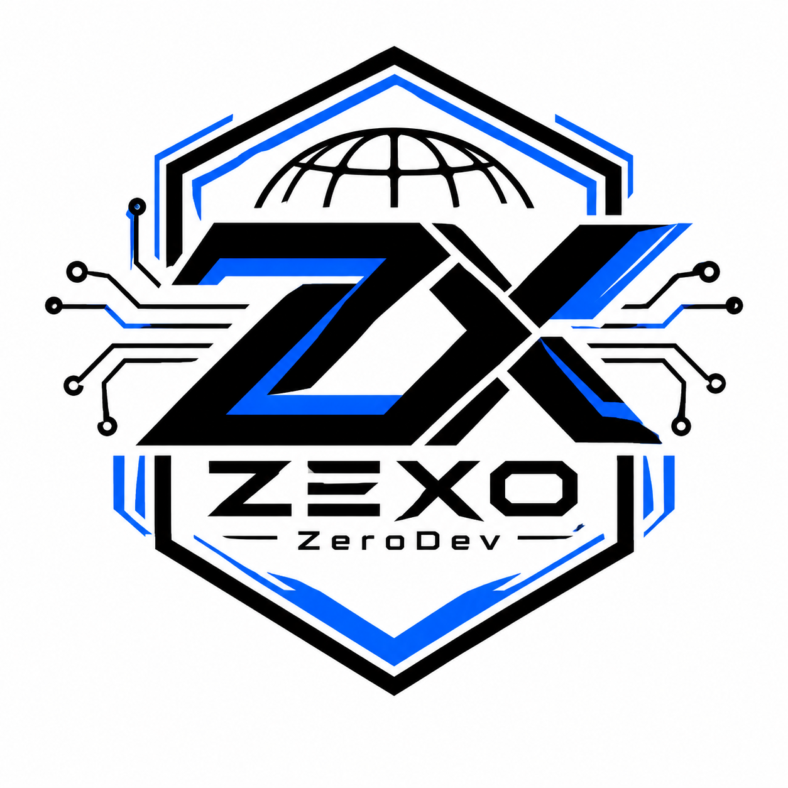
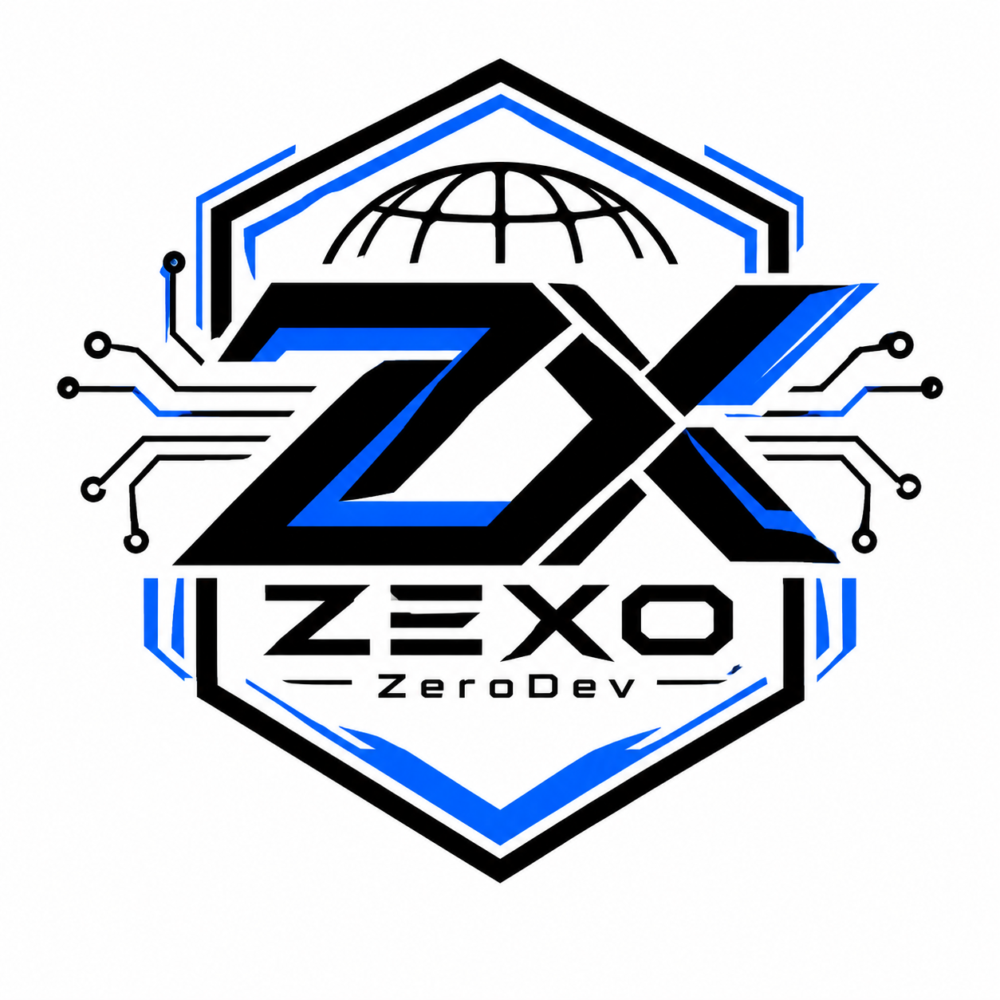

# Java4Shell Lab — CVE-2026-114938

<p align="center">
  
</p>

<p align="center">
  
</p>

<p align="center">
  
  
  
  
  
</p>

> **Lab edukasi untuk penelitian keamanan yang sah.** Target web rentan + detektor +
> exploit PoC untuk mempelajari **Java4Shell** (kerusakan heap pada decoder Base64
> OpenJDK). **Bukan senjata.** Tidak ada exploit RCE publik untuk CVE ini.

---

## TL;DR

**Java4Shell (CVE-2026-114938)** adalah kerusakan memori di decoder Base64
teroptimasi OpenJDK. Pada CPU **x86-64 dengan AVX-512 VBMI**, input Base64 cacat
membuat intrinsic assembly menulis **62 byte di luar buffer heap** sebelum JVM
menolak input. Dampaknya: crash JVM, kebocoran memori (**JavaBleed**), dan
(dalam penelitian tertutup) potensi **pre-auth RCE** pada Jira, Jenkins,
Keycloak, Confluence, Artifactory, PingFederate, dsb.

Repo ini berisi:

- **Target web rentan** (`VulnApp.java`) — endpoint nyata yang memicu decoder.
- **Detektor** (`detect.py`) — versi JVM, CPU AVX-512 VBMI, JVM berjalan, scan log.
- **Exploit PoC** (`exploit_poc.py`) — kirim payload Base64 cacat, deteksi crash.
- **Menu CLI** (`menu.py`) — orkestrasi semua alat.
- **Dockerfile** — jalankan di host AVX-512 VBMI.

---

## Daftar Isi

1. [Apa itu Java4Shell?](#1-apa-itu-java4shell)
2. [Detail teknis](#2-detail-teknis)
3. [Dampak & target](#3-dampak--target)
4. [Isi repo](#4-isi-repo)
5. [Syarat](#5-syarat)
6. [Quick start](#6-quick-start)
7. [Penggunaan tiap alat](#7-penggunaan-tiap-alat)
8. [Deteksi & hunting](#8-deteksi--hunting)
9. [Mitigasi & patch](#9-mitigasi--patch)
10. [Batasan lab](#10-batasan-lab)
11. [Etika & legal](#11-etika--legal)
12. [FAQ](#12-faq)
13. [Referensi](#13-referensi)
14. [Lisensi](#14-lisensi)

---

## 1. Apa itu Java4Shell?

`java.util.Base64.getDecoder()` pada JVM HotSpot tidak selalu memakai kode Java
murni. Di CPU x86-64 modern yang mendukung **AVX-512 VBMI**, JVM memakai
**intrinsic assembly** yang jauh lebih cepat. Intrinsic ini memiliki bug
penghitungan panjang: untuk input yang tidak valid — panjangnya bukan kelipatan
4 dan/atau ada `=` di akhir — intrinsic menghasilkan **panjang negatif** dan
menulis sejumlah byte di luar buffer output **sebelum** validasi Java membuang
input.

Akibatnya:

- **Crash / DoS** — mudah dipicu.
- **Kebocoran memori** — dijuluki **JavaBleed** (aliran data heap).
- **RCE** — diklaim peneliti dengan exploit chain khusus per aplikasi, namun
  **chain-nya tidak dipublikasikan**.

Ditemukan oleh **Calif** (Quang Luong) dan diungkapkan oleh Oracle/OpenJDK
Vulnerability Group pada **17 November 2026**.

---

## 2. Detail teknis

| Aspek | Nilai |
|---|---|
| CVE | CVE-2026-114938 |
| Nama | Java4Shell |
| Komponen | `java.util.Base64` decoder (HotSpot intrinsic) |
| Jenis | Heap out-of-bounds write / memory corruption |
| CVSS 4.0 | **9.2** (Calif) |
| CVSS 3.1 | 8.1 (Oracle / CISA) |
| Autentikasi | Tidak diperlukan di aplikasi yang men-decode input |
| Prasyarat CPU | x86-64 + **AVX-512 VBMI** |
| Garis JVM teraffeksi | 17.0.6–17.0.21, 21 < 21.0.13.1, 25 < 25.0.5.1, 27 < 27.0.1.1 |
| Tidak teraffeksi | Java 11, OpenJDK 8 standar, ARM64, x86 tanpa AVX-512 VBMI |

### Mekanisme

```
input Base64 cacat (len % 4 != 0, trailing '=')
        │
        ▼
intrinsic AVX-512 VBMI menghitung outLen negatif
        │
        ▼
write 62 byte di luar buffer heap  ──►  korupsi tetangga
        │
        ▼
JVM melempar IllegalArgumentException  ──►  crash / DoS
```

### Kenapa berliku

- Intrinsic hanya aktif di CPU tertentu → **cluster yang campur generasi CPU**
  bisa tiba-tiba rentan saat workload dijadwalkan ke node AVX-512.
- Gampang membuat **crash**, tapi **RCE susah**: butuh tata letak heap dan
  timing spesifik per aplikasi. Perkiraan OX Security: **< 0,12%** JVM berisiko
  RCE, ~0,8% berisiko crash.
- Sampai 19 November 2026: **tidak ada eksploitasi in-the-wild** yang dikonfirmasi,
  **belum masuk CISA KEV**, EPSS 0.

---

## 3. Dampak & target

Aplikasi apa pun yang men-decode input pengguna lewat `Base64` berisiko.
Contoh yang dibuktikan peneliti:

| Aplikasi | Jenis akses |
|---|---|
| Keycloak | pre-auth RCE |
| Jira | pre-auth RCE |
| Confluence | pre-auth RCE |
| Jenkins | pre-auth RCE |
| JFrog Artifactory | pre-auth RCE |
| PingFederate | pre-auth RCE |
| Kafka Broker | post-auth RCE |
| Solr / Elasticsearch | post-auth RCE |
| Gerrit / Spinnaker | post-auth RCE |
| Spring Boot + Spring Security | risiko via jalur Base64 (Basic auth, token) |

Jalur input umum: HTTP Basic credentials, cookie sesi, artefak SAML, JWT, CSRF
token — mana pun yang dilewatkan ke `Base64.Decoder`.

---

## 4. Isi repo

```
java4shell-lab/
├── VulnApp.java          # target web rentan (GET/POST /decode, /decode-basic, /health)
├── create_lab.py         # compile + start/stop lab
├── detect.py             # detektor: JVM, CPU, proses, log
├── exploit_poc.py        # PoC payload + deteksi crash/reject
├── menu.py               # menu CLI interaktif
├── Dockerfile            # image lab (host AVX-512 VBMI)
├── assets/
│   ├── banner.png        # banner repo (logo ZEXO · ZeroDev)
│   └── logo.png          # logo ZEXO · ZeroDev
├── README.md
├── SECURITY.md
└── LICENSE
```

---

## 5. Syarat

- **JDK** (buat compile/jalankan lab): versi teraffeksi idealnya 17.0.6–17.0.21.
  Versi ter-patch pun bisa dipakai untuk menguji detektor.
- **Python 3.8+** (stdlib saja, tanpa dependensi).
- **CPU AVX-512 VBMI** (Intel Ice Lake+/Tiger Lake/Xeon Scalable, AMD Zen 4+)
  untuk memicu bug sungguhan. Tanpa itu, lab tetap berguna untuk deteksi &
  demonstrasi jalur kode.
- **Docker** (opsional) untuk menjalankan versi JVM rentan di host AVX-512.

---

## 6. Quick start

### 6.1 Menu interaktif (paling gampang)

```bash
python menu.py
```

```
╔══════════════════════════════════════════════════════════════╗
║           J A V A 4 S H E L L   L A B                        ║
║           CVE-2026-114938 · OpenJDK Base64 decoder           ║
╠══════════════════════════════════════════════════════════════╣
║   [1]  Deteksi JVM + CPU + scan log          (detect.py)     ║
║   [2]  Compile + Start lab  (port 8080)      (create_lab)    ║
║   [3]  Jalankan exploit PoC                  (exploit_poc)   ║
║   [4]  Start lab mode MITIGASI (port 8081)   (create_lab)    ║
║   [5]  Status lab (health)                                   ║
║   [6]  Lihat log vulnapp.log                                 ║
║   [7]  Stop lab                                              ║
║   [0]  Keluar                                                ║
╚══════════════════════════════════════════════════════════════╝
  Pilih menu [0-7] >
```

### 6.2 Manual

```bash
# 1) deteksi dulu
python detect.py

# 2) buat + jalankan target
python create_lab.py            # http://127.0.0.1:8080

# 3) uji PoC
python exploit_poc.py --target http://127.0.0.1:8080
python exploit_poc.py --explain

# 4) bandingkan mode mitigasi
python create_lab.py --stop
python create_lab.py --mitigated --port 8081
python exploit_poc.py --target http://127.0.0.1:8081

# 5) selesai
python create_lab.py --stop
```

### 6.3 Docker (host AVX-512)

```bash
docker build -t java4shell-lab .
docker run --rm -p 8080:8080 java4shell-lab
python exploit_poc.py --target http://127.0.0.1:8080
```

> `ARG BASE` di `Dockerfile` bisa diganti ke image Temurin versi rentan apa pun
> (17.0.6–17.0.21). Cek ketersediaan tag di Hub.

---

## 7. Penggunaan tiap alat

### `create_lab.py`

| Flag | Fungsi |
|---|---|
| `--port N` | port lab (default 8080) |
| `--mitigated` | tambah `-XX:-UseBASE64Intrinsics` |
| `--compile-only` | compile saja |
| `--stop` | hentikan lab (via `lab.pid`) |

### `detect.py`

```bash
python detect.py                 # laporan manusia
python detect.py --json          # JSON
python detect.py --logs vulnapp.log hs_err_pid*.log
```

Contoh keluaran:

```
java version     : 17.0.20.1  (openjdk version "17.0.20.1" 2026-08-18)
affected         : True
cpu avx512_vbmi  : False  [Intel 9th/10th gen (...) - no AVX-512 VBMI]
risk             : MEDIUM (affected JVM, but CPU lacks AVX-512 VBMI)
mitigation       : -XX:-UseBASE64Intrinsics  (or -XX:UseAVX=2)
```

### `exploit_poc.py`

```bash
python exploit_poc.py --target http://127.0.0.1:8080
python exploit_poc.py --target http://127.0.0.1:8080 --method get
python exploit_poc.py --explain
```

Mengirim ~30 payload (panjang 31–195, trailing `=`/`==`) lalu melaporkan
`ok / rejected / crash`. Menolak = decoder melempar `IllegalArgumentException`.

### Endpoint target

| Endpoint | Contoh |
|---|---|
| `GET /decode?data=<base64>` | `curl "http://127.0.0.1:8080/decode?data=QUJDRA=="` |
| `POST /decode` (body mentah) | `curl -X POST --data-binary 'QUJDRA==' .../decode` |
| `GET /decode-basic` | `curl -H "Authorization: Basic QUJDRA==" .../decode-basic` |
| `GET /health` | cek proses |

---

## 8. Deteksi & hunting

### Signature log

- `java.util.Base64` + `IllegalArgumentException`
- pesan `Last unit does not have enough valid bits`
- pesan `Input byte array has wrong 4-byte ending unit`
- `hs_err_pid*.log` (JVM crash)
- `SIGSEGV` / `SIGBUS` / `EXCEPTION_ACCESS_VIOLATION`
- `OutOfMemoryError`
- kata `corrupt` / `corruption`

```bash
python detect.py --logs /var/log/myapp/*.log hs_err_pid*.log
```

### Indikator jaringan / aplikasi

- Token Base64 **≥ 32 char** di `Authorization`, cookie, atau parameter yang
  panjangnya **bukan kelipatan 4** dan berakhir `=`.
- Filter sempit: ≥ 65 char, `len % 64 ∈ {1,2,3}`, diakhiri satu/dua `=`.
- Ledakan restart JVM / `hs_err_pid*` yang tidak jelas penyebabnya.
- Proses JVM memulai shell atau koneksi keluar yang tidak biasa (pasca-eksploitasi).

### Deteksi versi & CPU

```bash
python detect.py            # cek java version + AVX-512 VBMI
# Linux: grep -o avx512_vbmi /proc/cpuinfo
```

---

## 9. Mitigasi & patch

### Patch vendor

| Vendor | Build tetap |
|---|---|
| Oracle Java SE | `8u513-perf`, `17.0.21.1`, `21.0.13.1`, `25.0.5.1`, `27.0.1.1` |
| Oracle GraalVM | `17.0.21.1`, `21.0.13.1`, Enterprise `21.3.20.1` |
| Amazon Corretto | `17.0.21.1.2`, `21.0.13.1.2`, `25.0.5.1.2`, `27.0.1.1.4` |
| Azul Zulu | `17.70.201`, `21.54.201`, `25.38.201`, `27.30.201` |
| SAP SapMachine | `17.0.21.1`, `21.0.13.1`, `25.0.5.1`, `27.0.1.1` |
| **Red Hat / Temurin / Microsoft / Liberica** | **belum ada fix** (per 19 Nov 2026) |

### Mitigasi sementara

```bash
-XX:-UseBASE64Intrinsics   # matikan intrinsic (semua arsitektur)
-XX:UseAVX=2               # matikan AVX-512 (x86-64)
```

Lalu **restart semua JVM** dan **rebuild/redeploy image container**.

### Kontrol kompensasi (CISA)

- Batasi akses jaringan eksternal ke layanan Java.
- Validasi/limit ukuran input Base64 di WAF/proxy.
- Prioritaskan sistem menghadap internet.

---

## 10. Batasan lab

- **Tidak ada exploit RCE publik.** Calif menahan chain-nya; yang beredar hanya
  reproducer crash. PoC di repo ini menargetkan **crash/korupsi**, bukan RCE.
- Klaim "RCE cukup kirim link" = **hoax**.
- Host tanpa AVX-512 VBMI **tidak dapat memicu** bug (intrinsic tak dipakai).
- Deteksi CPU di Windows memakai heuristik nama model; verifikasi definitif
  lewat `cpuinfo` (Linux) atau uji PoC di host AVX-512.

---

## 11. Etika & legal

- Gunakan **hanya** pada aset milik sendiri atau lingkungan yang secara eksplisit
  diberi izin.
- Jangan menargetkan sistem pihak lain. Bug ini **tidak** dilengkapi exploit
  publik, jadi tool ini untuk **pembelajaran & pertahanan**.
- Prioritas: patch dulu, cari tanda eksploitasi, batasi permukaan serangan.

---

## 12. FAQ

**T: Apakah ini bisa RCE?**
J: Tidak ada chain publik. PoC di sini memicu crash/korupsi. Jangan percaya
klaim sebaliknya.

**T: Kenapa lab di PC saya tidak crash?**
J: Butuh CPU x86-64 dengan AVX-512 VBMI. Cek `python detect.py`.

**T: Apakah Java 8 kena?**
J: Hanya build Enterprise Performance Pack `8u511b33-perf`. OpenJDK 8 standar
tidak terdaftar teraffeksi.

**T: Apakah ARM / Apple Silicon kena?**
J: Tidak. Intrinsic AVX-512 VBMI khusus x86-64.

**T: Bagaimana cara tahu server produksi kena?**
J: Cek versi JDK (affected range) + CPU AVX-512 VBMI. Kombinasi keduanya = HIGH.

---

## 13. Referensi

- NVD: <https://nvd.nist.gov/vuln/detail/CVE-2026-114938>
- Oracle Critical Patch Update: <https://www.oracle.com/security-alerts/>
- CISA KEV: <https://www.cisa.gov/known-exploited-vulnerabilities-catalog>
- OpenJDK Vulnerability Group
- Laporan media: BleepingComputer, The Hacker News, SecurityWeek, CSO Online
  (edisi 17–19 November 2026)

---

## 14. Lisensi

MIT — lihat [LICENSE](LICENSE). Gambar dan nama "Java4Shell" digunakan untuk
keperluan edukasi/keamanan; merek "Java" milik Oracle.

<p align="center"><i>Built for authorized security research · dev colab with hermes</i></p>
<p align="center"><sub>Logo: ZEXO · ZeroDev</sub></p>
